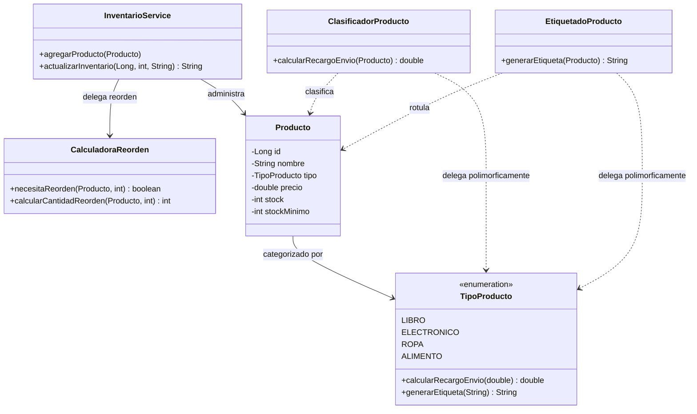
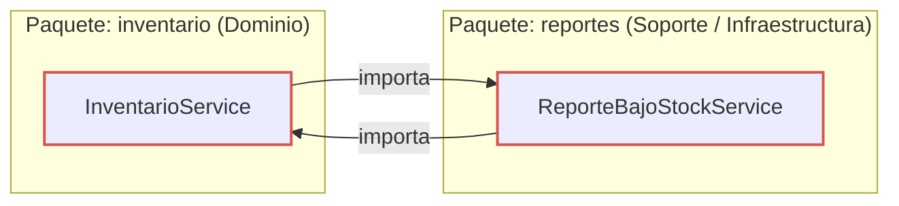

# Refactorizacion Guiada por Pruebas: Code Smells, Paquetes y Acoplamiento

## Descripcion General
Proyecto de refactorizacion guiada por pruebas para el sistema de gestion de inventario y clasificacion de productos (`refactoring-u11`). Desarrollado en Java 17 y Spring Boot 3.3.4, aplicando tecnicas formales de refactorizacion catalogadas por Martin Fowler y diseno orientado a objetos conforme a los principios SOLID.

---

## Tabla de Contenido
- [Arquitectura y Estructura de Paquetes](#arquitectura-y-estructura-de-paquetes)
- [Parte 1: Red de Seguridad y Refactorizacion de Code Smells](#parte-1-red-de-seguridad-y-refactorizacion-de-code-smells)
  - [Diagnostico de Code Smells Iniciales](#diagnostico-de-code-smells-iniciales)
  - [Pruebas de Caracterizacion](#pruebas-de-caracterizacion)
  - [Refactorizacion 1: Long Method en InventarioService](#refactorizacion-1-long-method-en-inventarioservice)
  - [Refactorizacion 2: Switch Statement Duplicado con Polimorfismo](#refactorizacion-2-switch-statement-duplicado-con-polimorfismo)
  - [Decisiones de Diseno (Parte 1)](#decisiones-de-diseno-parte-1)
- [Instrucciones de Ejecucion](#instrucciones-de-ejecucion)

---

## Arquitectura y Estructura de Paquetes



---

## Parte 1: Red de Seguridad y Refactorizacion de Code Smells

### Diagnostico de Code Smells Iniciales

1. **Long Method (Bloater) en `InventarioService.actualizarInventario()`**:
   - **Metricas iniciales**: 41 lineas de codigo, complejidad ciclomatica elevada (CC = 9).
   - **Responsabilidades mezcladas**:
     1. Validacion de datos de entrada (`productoId`, `cantidad`, formato de `tipoMovimiento`).
     2. Busqueda lineal del producto en la coleccion en memoria.
     3. Actualizacion del saldo de stock (incremento o decremento con validacion de saldo negativo).
     4. Calculo algoritmico de la cantidad de reabastecimiento (`(stockMinimo * 3) - nuevoStock`).
     5. Registro de auditoria en lista interna y consola (`System.out.println`).
     6. Evaluacion y emision de alertas de bajo stock.

2. **Switch Statements Duplicados (Object-Orientation Abusers) en `ClasificadorProducto` y `EtiquetadoProducto`**:
   - **Metricas iniciales**: 2 sentencias `switch` identicas evaluando las 4 constantes de `TipoProducto` (`LIBRO`, `ELECTRONICO`, `ROPA`, `ALIMENTO`).
   - **Problema de diseno**: Violacion del Principio Abierto/Cerrado (OCP) y riesgo inminente de *Shotgun Surgery*. La introduccion de un nuevo tipo de producto obligaba a modificar ambas clases concurrentemente.

---

### Pruebas de Caracterizacion

Antes de alterar una sola linea de la logica original, se construyo una suite de 14 pruebas de caracterizacion ejecutadas directamente sobre instancias POJO (sin dependencias pesadas de Spring), cubriendo exhaustivamente todos los caminos y condiciones de error:

| Suite de Pruebas | Casos Verificados | Resultado Inicial |
| :--- | :--- | :---: |
| `InventarioServiceTest` | Entrada valida, salida valida, stock insuficiente, reorden bajo minimo, movimiento invalido, producto inexistente (6 pruebas) | Verde |
| `ClasificadorProductoTest` | Recargo Libro (0%), Electronico (8%), Ropa (3%), Alimento ($2.50) (4 pruebas) | Verde |
| `EtiquetadoProductoTest` | Etiqueta Libro, Electronico, Ropa, Alimento (4 pruebas) | Verde |

---

### Refactorizacion 1: Long Method en InventarioService

Se aplico la tecnica **Extract Method** complementada con **Extract Class** para delegar la politica de reabastecimiento en `CalculadoraReorden`:

- **Antes**: 41 lineas, 5 responsabilidades entrelazadas.
- **Despues**: 10 lineas en `actualizarInventario()`, delegando en metodos privados con nombres que revelan intencion (`esValido`, `buscarProducto`, `calcularNuevoStock`, `registrarAuditoria`, `procesarResultadoReorden`).

```java
public String actualizarInventario(Long productoId, int cantidad, String tipoMovimiento) {
    if (!esValido(productoId, cantidad, tipoMovimiento)) return "ERROR_DATOS_INVALIDOS";
    Producto producto = buscarProducto(productoId);
    if (producto == null) return "ERROR_PRODUCTO_NO_EXISTE";
    int nuevoStock = calcularNuevoStock(producto, cantidad, tipoMovimiento);
    if (nuevoStock < 0) return "ERROR_STOCK_INSUFICIENTE";
    producto.setStock(nuevoStock);
    registrarAuditoria(tipoMovimiento, cantidad, producto, nuevoStock);
    return procesarResultadoReorden(producto, nuevoStock);
}
```

---

### Refactorizacion 2: Switch Statement Duplicado con Polimorfismo

Se aplico la tecnica **Replace Conditional with Polymorphism**:
- Las operaciones discriminantes (`calcularRecargoEnvio` y `generarEtiqueta`) se trasladaron al enum `TipoProducto` mediante metodos abstractos implementados por cada constante.
- `ClasificadorProducto` y `EtiquetadoProducto` redujeron su logica a una invocacion polimorfica lineal de una sola linea, eliminando el 100% de bifurcaciones condicionales.

---

### Decisiones de Diseno (Parte 1)

#### Decision de Diseno 1: Extraccion de CalculadoraReorden como Colaborador Independiente
- **Contexto**: Al descomponer `actualizarInventario()`, debia definirse si el calculo de reorden permanecia como metodo privado o se extraia como clase independiente.
- **Decision**: Se extrajo la clase colaboradora `CalculadoraReorden`.
- **Justificacion**: La determinacion de necesidad y volumen de reabastecimiento responde a politicas comerciales y de abastecimiento de la empresa (rotacion, stock de seguridad, multiplicadores), mientras que `InventarioService` es un orquestador del ciclo de vida del stock. Al aislar la logica en `CalculadoraReorden`, se cumple el Principio de Responsabilidad Unica (SRP) con un eje de cambio independiente.
- **Alternativa descartada**: Mantener un metodo privado en `InventarioService`. Se descarto porque mezclaria reglas de politica de compras con la orquestacion de movimientos fisicos.

#### Decision de Diseno 2: Polimorfismo en Constantes de TipoProducto vs Jerarquia de Estrategia
- **Contexto**: Seleccion del mecanismo de polimorfismo para sustituir los condicionales duplicados.
- **Decision**: Polimorfismo basado en constantes especificas del enum `TipoProducto`.
- **Justificacion**: El dominio actual presenta un conjunto cerrado, estable y altamente cohesivo de tipos de producto (`LIBRO`, `ELECTRONICO`, `ROPA`, `ALIMENTO`). Implementar metodos abstractos en el enum resuelve el problema sin anadir sobrecarga estructural ni crear 8 clases adicionales.
- **Alternativa descartada**: Jerarquia completa con interfaz `RecargoStrategy` y `EtiquetaStrategy` con clases concretas. Se considero innecesariamente compleja para las necesidades actuales (YAGNI), aunque documentada como camino evolutivo si en el futuro los tipos requirieran servicios inyectados por Spring.

---

## Parte 2: Diagnostico y Resolucion de Acoplamiento entre Paquetes

### Diagnostico: Deteccion de Dependencia Ciclica con ArchUnit (En Rojo)

Al integrar el modulo de reportes (`ReporteBajoStockService`), se introdujo inadvertidamente un ciclo de dependencias directo entre los paquetes `inventario` y `reportes`:



#### Evidencia del Fallo en Rojo (`ArquitecturaPaquetesTest`)
Al ejecutar la regla de arquitectura en ArchUnit:
```bash
mvn test -Dtest=ArquitecturaPaquetesTest
```
La prueba falla reportando la violacion arquitectonica:
```text
[ERROR] Failures: 
[ERROR]   ArquitecturaPaquetesTest.losPaquetesNoDebenTenerDependenciasCiclicas:18 
Architecture Violation [Priority: MEDIUM] - Rule 'slices matching 'com.universidad.refactoringu11.(*)..' should be free of cycles' was violated (1 times):
Cycle detected: Slice inventario -> Slice reportes -> Slice inventario
  1. Dependencies of Slice inventario
    - Field <InventarioService.reporteBajoStockService> has type <ReporteBajoStockService>
    - Method <InventarioService.setReporteBajoStockService(ReporteBajoStockService)>
    - Method <InventarioService.procesarResultadoReorden(...)> calls method <ReporteBajoStockService.generarReporte()>
  2. Dependencies of Slice reportes
    - Constructor <ReporteBajoStockService.<init>(InventarioService)>
    - Field <ReporteBajoStockService.inventarioService> has type <InventarioService>
```

**Observacion clave**: Todas las pruebas unitarias de logica de negocio (`InventarioServiceTest`, `ClasificadorProductoTest`, `EtiquetadoProductoTest`) continuaron pasando en verde durante este estado. Esto evidencia empíricamente que las fallas de arquitectura y acoplamiento estructural no se manifiestan como errores funcionales visibles, requiriendo pruebas de arquitectura automatizadas para su fiscalizacion continua.

---

## Instrucciones de Ejecucion

### Compilacion y Ejecucion de Pruebas en Windows PowerShell:
```powershell
mvn clean test
```

### Compilacion y Reporte de Cobertura JaCoCo:
```powershell
mvn test jacoco:report
```
El reporte HTML se genera en `target/site/jacoco/index.html`.