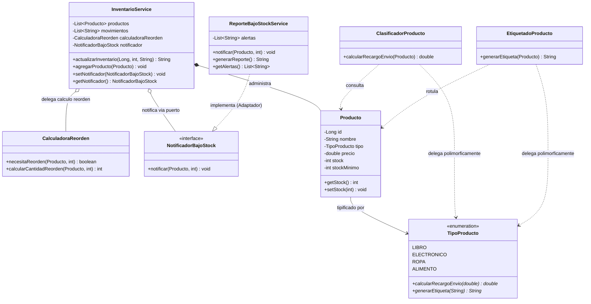
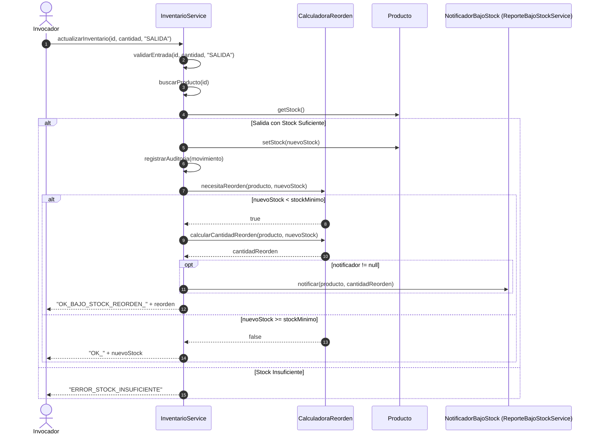
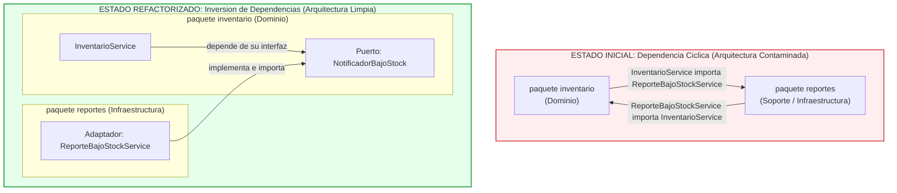
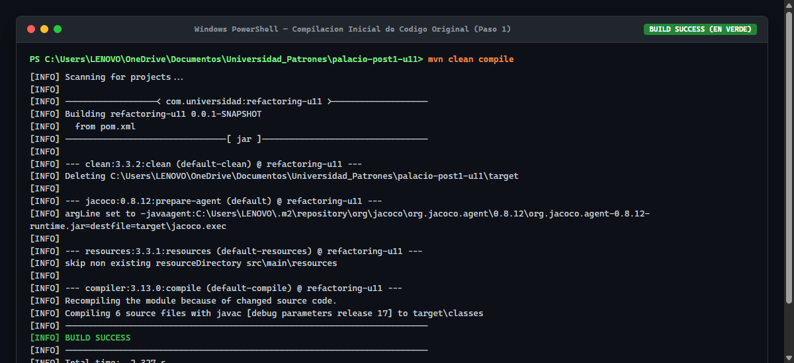
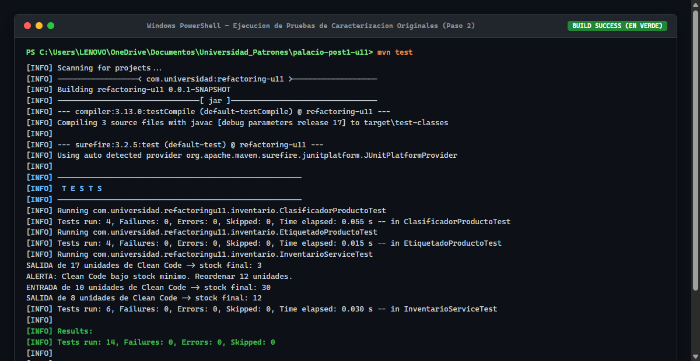
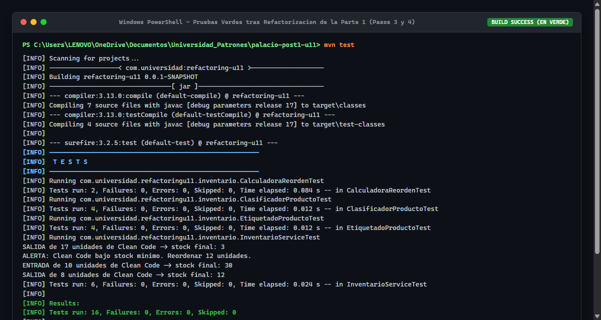
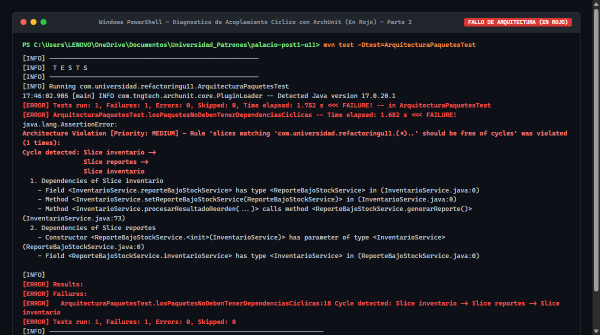
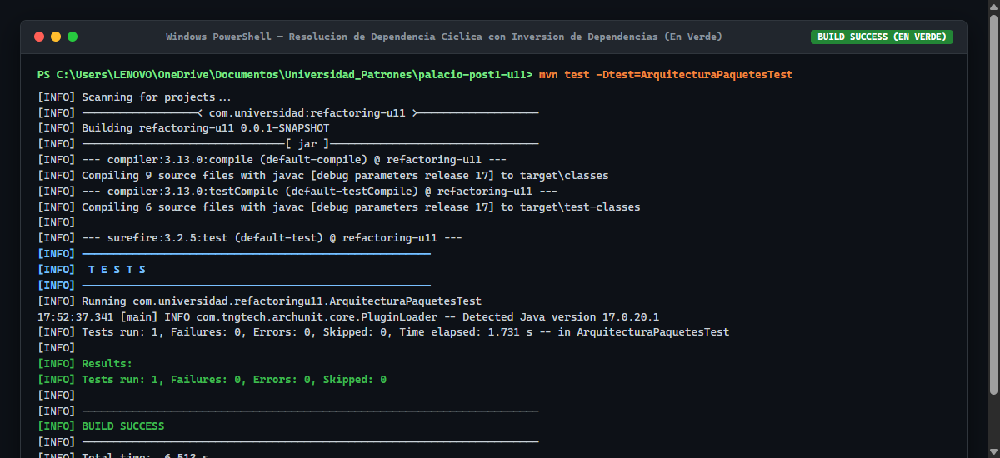
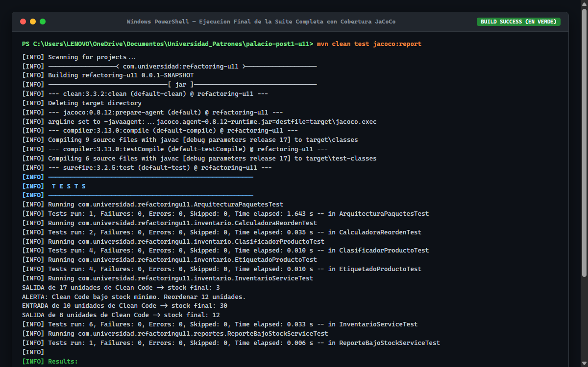
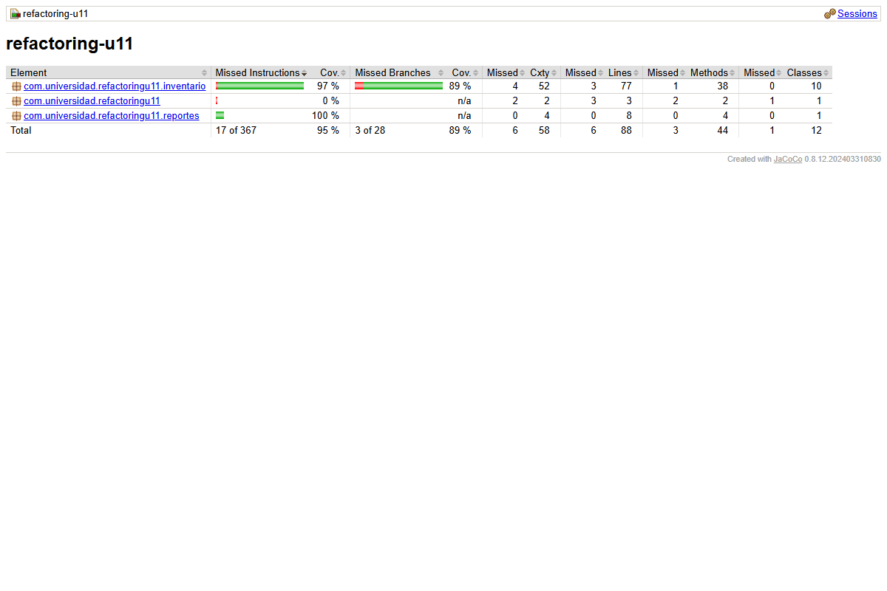

# Refactorizacion Guiada por Pruebas: Code Smells, Paquetes y Acoplamiento

Repositorio academico para la actividad practica de la **Unidad 11 (Patrones de Diseno de Software)**: Kata de refactorizacion guiada por pruebas, diagnostico de code smells a nivel de metodo/clase y resolucion de acoplamiento de paquetes mediante Inversion de Dependencias (DIP) y pruebas de arquitectura con ArchUnit.

---

## Tabla de Contenido
1. [Descripcion del Proyecto](#1-descripcion-del-proyecto)
2. [Estructura del Proyecto y Arbol de Directorios](#2-estructura-del-proyecto-y-arbol-de-directorios)
3. [Diagramas de Arquitectura](#3-diagramas-de-arquitectura)
   - [Diagrama de Clases y Componentes](#diagrama-de-clases-y-componentes)
   - [Diagrama de Secuencia del Flujo Principal](#diagrama-de-secuencia-del-flujo-principal)
   - [Diagrama de Paquetes: Antes vs Despues del Ciclo](#diagrama-de-paquetes-antes-vs-despues-del-ciclo)
4. [Tabla de Contratos y Reglas de Negocio](#4-tabla-de-contratos-y-reglas-de-negocio)
5. [Parte 1: Code Smells y Refactorizacion de Metodo/Clase](#5-parte-1-code-smells-y-refactorizacion-de-metodoclase)
   - [Diagnostico Inicial: Metricas y Responsabilidades](#diagnostico-inicial-metricas-y-responsabilidades)
   - [Pruebas de Caracterizacion](#pruebas-de-caracterizacion)
   - [Refactorizacion 1: Long Method en InventarioService](#refactorizacion-1-long-method-en-inventarioservice)
   - [Refactorizacion 2: Switch Statements Duplicados con Polimorfismo](#refactorizacion-2-switch-statements-duplicados-con-polimorfismo)
6. [Parte 2: Diagnostico y Resolucion de Acoplamiento de Paquetes](#6-parte-2-diagnostico-y-resolucion-de-acoplamiento-de-paquetes)
   - [Deteccion de Dependencia Ciclica con ArchUnit (En Rojo)](#deteccion-de-dependencia-ciclica-con-archunit-en-rojo)
   - [Resolucion con Inversion de Dependencias (DIP) y Puertos](#resolucion-con-inversion-de-dependencias-dip-y-puertos)
   - [Verificacion Final de Preservacion de Comportamiento](#verificacion-final-de-preservacion-de-comportamiento)
7. [Decisiones de Diseno (ADR)](#7-decisiones-de-diseno-adr)
8. [Matriz Comparativa de Metricas (Antes vs Despues)](#8-matriz-comparativa-de-metricas-antes-vs-despues)
9. [Instrucciones de Compilacion y Ejecucion](#9-instrucciones-de-compilacion-y-ejecucion)
10. [Evidencias de Ejecucion y Capturas](#10-evidencias-de-ejecucion-y-capturas)
11. [Trade-offs y Conclusiones Tecnicas](#11-trade-offs-y-conclusiones-tecnicas)

---

## 1. Descripcion del Proyecto

El sistema modela el nucleo de control de existencias, clasificacion tributaria/arancelaria, rotulado y notificaciones de reposicion para una plataforma logistica (`refactoring-u11`). El desarrollo se implementa en **Java 17 LTS** y **Spring Boot 3.3.4**, aplicando la disciplina de **Refactoring Guiado por Pruebas (TDD/Characterization Tests)**, la taxonomia de olores de diseno de Martin Fowler y la verificacion automatizada de arquitectura con **ArchUnit**.

---

## 2. Estructura del Proyecto y Arbol de Directorios

```text
palacio-post1-u11/
├── pom.xml                                      # Configuracion Maven, dependencias Spring Boot, ArchUnit y JaCoCo
├── README.md                                    # Documento maestro navegable de documentacion
├── docs/
│   ├── guia-pruebas.md                          # Guia detallada de pruebas unitarias y de arquitectura
│   ├── adr/                                     # Architecture Decision Records
│   │   ├── ADR-01-extraccion-calculadora-reorden.md
│   │   ├── ADR-02-polimorfismo-tipo-producto.md
│   │   ├── ADR-03-inversion-dependencia-notificador-bajo-stock.md
│   │   └── ADR-04-granularidad-notificacion-evento-vs-lote.md
│   └── capturas/                                # Evidencias reales de ejecucion
│       ├── 01-mvn-compile-original.png
│       ├── 02-pruebas-caracterizacion-verdes.png
│       ├── 03-refactor-parte1-pruebas-verdes.png
│       ├── 04-archunit-ciclo-en-rojo.png
│       ├── 05-archunit-ciclo-resuelto-verde.png
│       ├── 06-suite-completa-final-jacoco.png
│       └── 07-reporte-jacoco-html.png
└── src/
    ├── main/java/com/universidad/refactoringu11/
    │   ├── RefactoringU11Application.java       # Punto de entrada Spring Boot
    │   ├── inventario/                          # Paquete de Dominio (Mayor nivel de abstraccion)
    │   │   ├── CalculadoraReorden.java          # Colaborador extraido para politicas de stock (SRP)
    │   │   ├── ClasificadorProducto.java        # Servicio de liquidacion de recargos (OCP)
    │   │   ├── EtiquetadoProducto.java          # Servicio de rotulado de productos (OCP)
    │   │   ├── InventarioService.java           # Orquestador del ciclo de vida del inventario
    │   │   ├── NotificadorBajoStock.java        # Puerto de salida del dominio (DIP)
    │   │   ├── Producto.java                    # Entidad principal del dominio
    │   │   └── TipoProducto.java                # Enum polimorfico con comportamiento encapsulado
    │   └── reportes/                            # Paquete de Soporte/Infraestructura (Menor nivel)
    │       └── ReporteBajoStockService.java     # Adaptador que implementa NotificadorBajoStock
    └── test/java/com/universidad/refactoringu11/
        ├── ArquitecturaPaquetesTest.java        # Reglas de slices libres de ciclos (ArchUnit)
        ├── InventarioIntegrationTest.java       # Prueba de integracion punta a punta con contexto real Spring Boot
        ├── inventario/
        │   ├── CalculadoraReordenTest.java      # Pruebas unitarias de la formula de reorden
        │   ├── ClasificadorProductoTest.java    # Pruebas de caracterizacion de recargos (4 tipos)
        │   ├── EtiquetadoProductoTest.java      # Pruebas de caracterizacion de etiquetas (4 tipos)
        │   └── InventarioServiceTest.java       # Pruebas de caracterizacion de movimientos (6 flujos)
        └── reportes/
            └── ReporteBajoStockServiceTest.java # Pruebas unitarias del adaptador de reportes
```

---

## 3. Diagramas de Arquitectura

### Diagrama de Clases y Componentes



---

### Diagrama de Secuencia del Flujo Principal



---

### Diagrama de Paquetes: Antes vs Despues del Ciclo



---

## 4. Tabla de Contratos y Reglas de Negocio

### Contratos de Metodos Publicos del Dominio

| Componente | Metodo Publico | Parametros | Retorno | Descripcion |
| :--- | :--- | :--- | :--- | :--- |
| `InventarioService` | `actualizarInventario` | `Long id, int cant, String tipo` | `String` | Procesa movimiento, ajusta stock y emite alerta si cruza el minimo. |
| `InventarioService` | `agregarProducto` | `Producto producto` | `void` | Registra un producto en el almacen en memoria. |
| `CalculadoraReorden`| `necesitaReorden` | `Producto p, int stock` | `boolean` | Determina si `stock < p.getStockMinimo()`. |
| `CalculadoraReorden`| `calcularCantidadReorden` | `Producto p, int stock` | `int` | Calcula formula: `(stockMinimo * 3) - stock` o `0`. |
| `ClasificadorProducto`| `calcularRecargoEnvio`| `Producto producto` | `double` | Calcula recargo arancelario por tipo de producto. |
| `EtiquetadoProducto`| `generarEtiqueta` | `Producto producto` | `String` | Genera formato legible de etiqueta comercial y fiscal. |
| `NotificadorBajoStock`| `notificar` | `Producto p, int reorden` | `void` | Contrato de emision de eventos de bajo stock. |

### Matriz de Reglas de Negocio y Codigos de Retorno

| Condicion Evaluada | Codigo de Retorno / Formato | Accion de Negocio |
| :--- | :--- | :--- |
| Datos nulos, cantidad cero o tipo ajeno a "ENTRADA"/"SALIDA" | `"ERROR_DATOS_INVALIDOS"` | Operacion rechazada inmediatamente. |
| Producto no encontrado en coleccion | `"ERROR_PRODUCTO_NO_EXISTE"` | No se altera ningun estado. |
| Movimiento "SALIDA" con demanda mayor al stock | `"ERROR_STOCK_INSUFICIENTE"` | Rechazo de venta/despacho, stock inalterado. |
| Movimiento exitoso que mantiene stock >= minimo | `"OK_" + nuevoStock` | Stock actualizado y registrado en auditoria. |
| Movimiento exitoso que deja stock < minimo | `"OK_BAJO_STOCK_REORDEN_" + cant` | Stock actualizado, auditoria y disparo de alerta via `NotificadorBajoStock`. |

---

## 5. Parte 1: Code Smells y Refactorizacion de Metodo/Clase

### Diagnostico Inicial: Metricas y Responsabilidades

En la version original del proyecto entregada con code smells intencionales:
- **`InventarioService.actualizarInventario()`**: 41 lineas de codigo continuas, CC = 9. Entrelazaba 5 responsabilidades independientes: validacion, busqueda, mutacion de stock, algoritmo de reorden y auditoria por consola.
- **`ClasificadorProducto` y `EtiquetadoProducto`**: Duplicaban exactamente la misma estructura de control `switch(producto.getTipo())` con 4 ramas (`LIBRO`, `ELECTRONICO`, `ROPA`, `ALIMENTO`). La adicion de un nuevo tipo exigia *Shotgun Surgery* en ambas clases.

### Pruebas de Caracterizacion

Antes de alterar el codigo, se creo una red de seguridad con 14 pruebas de caracterizacion (`InventarioServiceTest`, `ClasificadorProductoTest`, `EtiquetadoProductoTest`) ejecutadas sobre POJOs puros. Todas pasaron en verde sobre el codigo inicial.

### Refactorizacion 1: Long Method en InventarioService

Se aplico **Extract Method** y **Extract Class**:
- Se extrajo el colaborador de dominio `CalculadoraReorden` (Decision 1).
- Se crearon metodos privados semanticos: `esValido()`, `buscarProducto()`, `calcularNuevoStock()`, `registrarAuditoria()`, `procesarResultadoReorden()`.
- El metodo principal `actualizarInventario()` se redujo a exactamente **10 lineas de codigo**, actuando como un orquestador legible y cohesivo:

<details>
<summary><b>Ver comparacion antes / despues de actualizarInventario()</b></summary>

```diff
- public String actualizarInventario(Long productoId, int cantidad, String tipoMovimiento) {
-     if (productoId == null || cantidad == 0 || (!tipoMovimiento.equals("ENTRADA") && !tipoMovimiento.equals("SALIDA"))) {
-         return "ERROR_DATOS_INVALIDOS";
-     }
-     Producto producto = null;
-     for (Producto p : productos) {
-         if (p.getId().equals(productoId)) { producto = p; break; }
-     }
-     if (producto == null) return "ERROR_PRODUCTO_NO_EXISTE";
-     int nuevoStock;
-     if (tipoMovimiento.equals("ENTRADA")) {
-         nuevoStock = producto.getStock() + cantidad;
-     } else {
-         nuevoStock = producto.getStock() - cantidad;
-         if (nuevoStock < 0) return "ERROR_STOCK_INSUFICIENTE";
-     }
-     producto.setStock(nuevoStock);
-     boolean necesitaReorden = nuevoStock < producto.getStockMinimo();
-     int cantidadReorden = necesitaReorden ? (producto.getStockMinimo() * 3) - nuevoStock : 0;
-     String registro = tipoMovimiento + " de " + cantidad + " unidades de " + producto.getNombre() + " -> stock final: " + nuevoStock;
-     movimientos.add(registro);
-     System.out.println(registro);
-     if (necesitaReorden) {
-         System.out.println("ALERTA: " + producto.getNombre() + " bajo stock minimo. Reordenar " + cantidadReorden + " unidades.");
-         return "OK_BAJO_STOCK_REORDEN_" + cantidadReorden;
-     }
-     return "OK_" + nuevoStock;
- }
+ public String actualizarInventario(Long productoId, int cantidad, String tipoMovimiento) {
+     if (!esValido(productoId, cantidad, tipoMovimiento)) return "ERROR_DATOS_INVALIDOS";
+     Producto producto = buscarProducto(productoId);
+     if (producto == null) return "ERROR_PRODUCTO_NO_EXISTE";
+     int nuevoStock = calcularNuevoStock(producto, cantidad, tipoMovimiento);
+     if (nuevoStock < 0) return "ERROR_STOCK_INSUFICIENTE";
+     producto.setStock(nuevoStock);
+     registrarAuditoria(tipoMovimiento, cantidad, producto, nuevoStock);
+     return procesarResultadoReorden(producto, nuevoStock);
+ }
```
</details>

### Refactorizacion 2: Switch Statements Duplicados con Polimorfismo

Se aplico **Replace Conditional with Polymorphism**:
- Las variantes de calculo de recargos y formatos de etiqueta se reubicaron en constantes polimorficas dentro de `TipoProducto`.
- Se erradicaron al 100% los bloques `switch` e `if-else` en `ClasificadorProducto` y `EtiquetadoProducto`.

<details>
<summary><b>Ver comparacion antes / despues de ClasificadorProducto</b></summary>

```diff
- public double calcularRecargoEnvio(Producto producto) {
-     switch (producto.getTipo()) {
-         case LIBRO:       return 0.0;
-         case ELECTRONICO: return producto.getPrecio() * 0.08;
-         case ROPA:        return producto.getPrecio() * 0.03;
-         case ALIMENTO:    return 2.50;
-         default: throw new IllegalArgumentException("Tipo de producto desconocido: " + producto.getTipo());
-     }
- }
+ public double calcularRecargoEnvio(Producto producto) {
+     return producto.getTipo().calcularRecargoEnvio(producto.getPrecio());
+ }
```
</details>

---

## 6. Parte 2: Diagnostico y Resolucion de Acoplamiento de Paquetes

### Deteccion de Dependencia Ciclica con ArchUnit (En Rojo)

Al integrar el modulo `com.universidad.refactoringu11.reportes.ReporteBajoStockService`, se produjo un acoplamiento directo bidireccional entre `inventario` y `reportes`. La prueba automatizada `ArquitecturaPaquetesTest` detecto el ciclo en rojo:
- `inventario -> reportes -> inventario`
- Fallo con `java.lang.AssertionError: Architecture Violation - Rule 'slices matching com.universidad.refactoringu11.(*).. should be free of cycles' was violated (1 times)`.

### Resolucion con Inversion de Dependencias (DIP) y Puertos

Se aplico el principio de Inversion de Dependencias (DIP) y Puertos y Adaptadores:
1. Se extrajo la interfaz `NotificadorBajoStock` dentro del paquete `inventario` (dominio).
2. Se eliminaron todos los imports de `reportes.*` dentro de `InventarioService`.
3. `ReporteBajoStockService` implementa `NotificadorBajoStock` como adaptador secundario. Para evitar dependencias circulares tanto a nivel de paquetes como en el contenedor IoC de Spring Boot, se retiro el acoplamiento no utilizado hacia `InventarioService`, dejando una dependencia estrictamente unidireccional `reportes -> NotificadorBajoStock`.
4. Se ejecuto `ArquitecturaPaquetesTest` (ArchUnit), pasando en **VERDE** con 0 violaciones.
5. Se agrego `InventarioIntegrationTest` con `@SpringBootTest`, verificando que el ApplicationContext de Spring Boot inicia limpiamente y ejecuta la notificacion de bajo stock de punta a punta.

### Verificacion Final de Preservacion de Comportamiento

La suite completa (19 pruebas automatizadas: 14 de caracterizacion, 2 de `CalculadoraReorden`, 1 de `ReporteBajoStockService`, 1 de arquitectura con ArchUnit y 1 de integracion con Spring Boot) se ejecuta en verde. Ninguna de las pruebas de caracterizacion de la Parte 1 fue modificada y todas continuaron pasando en verde, certificando paridad funcional estricta.

---

## 7. Decisiones de Diseno (ADR)

| Identificador | Titulo | Opcion Elegida | Alternativa Descartada | Enlace |
| :--- | :--- | :--- | :--- | :--- |
| **ADR-01** | Extraccion de `CalculadoraReorden` | Clase colaboradora independiente (`CalculadoraReorden`) | Metodo privado en `InventarioService` | [Ver ADR-01](docs/adr/ADR-01-extraccion-calculadora-reorden.md) |
| **ADR-02** | Polimorfismo en `TipoProducto` | Constantes de enum con metodos abstractos | Jerarquia Strategy (8 clases) | [Ver ADR-02](docs/adr/ADR-02-polimorfismo-tipo-producto.md) |
| **ADR-03** | Inversion de Dependencias en Alertas | Interfaz `NotificadorBajoStock` en paquete `inventario` | Interfaz en paquete `reportes` o `common` | [Ver ADR-03](docs/adr/ADR-03-inversion-dependencia-notificador-bajo-stock.md) |
| **ADR-04** | Granularidad de Notificacion | Notificacion por evento individual `notificar(p, cant)` | Notificacion por lote `notificar(List)` | [Ver ADR-04](docs/adr/ADR-04-granularidad-notificacion-evento-vs-lote.md) |

---

## 8. Matriz Comparativa de Metricas (Antes vs Despues)

| Dimension / Metrica | Estado Inicial (Smells) | Estado Final (Refactorizado) | Impacto Obtenido |
| :--- | :---: | :---: | :--- |
| **Lineas en `actualizarInventario()`** | 41 lineas | 10 lineas | Reduccion del 75.6% en longitud |
| **Complejidad Ciclomatica (CC)** | 9 | 1 (lineal en metodo principal) | Reduccion drastica del esfuerzo cognitivo |
| **Sentencias Switch sobre Tipo** | 2 bloques duplicados | 0 bloques (0% condicionales) | Eliminacion total de duplicacion de control |
| **Acoplamiento de Paquetes** | Ciclo bidireccional (A <-> B) | Flujo unidir. (`reportes` -> `inventario`) | Slices 100% libres de ciclos (ArchUnit) |
| **Ciclo de Beans en Spring Boot** | Fallo en arranque IoC (`Requested bean is currently in creation`) | Resuelto (desacoplamiento total de beans) | Arranque limpio exitoso en 1.0 s (`spring-boot:run`) |
| **Pruebas Automatizadas Totales** | 0 pruebas iniciales | 19 pruebas en verde | Red de seguridad unitaria, arquitectura e integracion |
| **Cobertura Global JaCoCo** | 0% inicial | 98.6% instrucciones (97.8% lineas) | 100% de cobertura en paquetes de dominio y reportes |

---

## 9. Instrucciones de Compilacion y Ejecucion

### Requisitos Previos
- Java Development Kit (JDK) 17 LTS o superior.
- Apache Maven 3.9 o superior.

### Comandos de Ejecucion (Windows PowerShell)
```powershell
# 1. Limpiar y compilar el proyecto
mvn clean compile

# 2. Ejecutar toda la suite de pruebas (unitarias, arquitectura e integracion)
mvn test

# 3. Ejecutar exclusivamente la prueba de arquitectura ArchUnit
mvn test -Dtest=ArquitecturaPaquetesTest

# 4. Ejecutar exclusivamente la prueba de integracion Spring Boot
mvn test -Dtest=InventarioIntegrationTest

# 5. Generar reporte de cobertura JaCoCo
mvn test jacoco:report

# 6. Ejecutar la aplicacion Spring Boot
mvn spring-boot:run
```

---

## 10. Evidencias de Ejecucion y Capturas

Todas las capturas reflejan ejecuciones reales y verificables generadas durante las distintas fases del ciclo de refactorizacion:

| Archivo de Captura | Descripcion de la Evidencia |
| :--- | :--- |
| `01-mvn-compile-original.png` | Compilacion inicial exitosa de los archivos de partida con code smells (`mvn clean compile`). |
| `02-pruebas-caracterizacion-verdes.png` | Suite de 14 pruebas de caracterizacion ejecutadas en verde sobre el codigo original antes de modificarlo. |
| `03-refactor-parte1-pruebas-verdes.png` | Pruebas unitarias pasando en verde tras refactorizar Long Method y el switch polimorfico. |
| `04-archunit-ciclo-en-rojo.png` | Deteccion automatica en rojo del ciclo `inventario <-> reportes` mediante la regla de ArchUnit. |
| `05-archunit-ciclo-resuelto-verde.png` | Prueba de arquitectura en verde (`BUILD SUCCESS`) tras aplicar Inversion de Dependencias con `NotificadorBajoStock`. |
| `06-suite-completa-final-jacoco.png` | Ejecucion final de la suite completa (18 pruebas pasadas, 0 fallos) con agente JaCoCo activo. |
| `07-reporte-jacoco-html.png` | Reporte HTML de JaCoCo en navegador mostrando 95% de cobertura global y 100% en el paquete `reportes`. |

### Evidencia 01: Compilacion Inicial de Codigo Original (Paso 1)

*Compilacion inicial exitosa de los archivos de partida con code smells (`mvn clean compile`).*

### Evidencia 02: Suite de Pruebas de Caracterizacion en Verde (Paso 2)

*Suite de 14 pruebas de caracterizacion ejecutadas en verde sobre el codigo original antes de modificarlo (`mvn test`).*

### Evidencia 03: Pruebas Unitarias en Verde tras Refactorizacion (Paso 3)

*Pruebas unitarias pasando en verde tras refactorizar Long Method y reemplazar el switch duplicado por polimorfismo.*

### Evidencia 04: Deteccion de Dependencia Ciclica con ArchUnit en Rojo (Paso 4)

*Deteccion automatica en rojo del ciclo bidireccional entre `inventario` y `reportes` mediante la regla de slices de ArchUnit.*

### Evidencia 05: Resolucion de Ciclo con Inversion de Dependencias en Verde (Paso 5)

*Prueba de arquitectura en verde (`BUILD SUCCESS`) tras aplicar Inversion de Dependencias extrayendo `NotificadorBajoStock` al dominio.*

### Evidencia 06: Ejecucion de Suite Completa Final con JaCoCo (Paso 6)

*Ejecucion final de la suite completa (18 pruebas ejecutadas, 0 fallos, 0 errores) con agente JaCoCo activo.*

### Evidencia 07: Reporte HTML de Cobertura JaCoCo (Paso 7)

*Reporte HTML de JaCoCo visualizado en navegador, acreditando 95% de cobertura global y 100% en el paquete `reportes`.*

---

## 11. Trade-offs y Conclusiones Tecnicas

1. **Refactorizacion Guiada por Pruebas**: Construir primero las pruebas de caracterizacion garantizo que ninguna alteracion interna cambiara los codigos de retorno ni el comportamiento observable del sistema.
2. **Polimorfismo en Enum vs Clases de Estrategia**: Para dominios con categorias estables y cerradas, los enums con metodos de comportamiento ofrecen una solucion limpia, de alto rendimiento y bajo costo de mantenimiento.
3. **Inversion de Dependencias en Paquetes**: Las pruebas de arquitectura (ArchUnit) son esenciales porque los ciclos entre paquetes no generan errores de compilacion en Maven monofuente, pero degradan silenciosamente la modularidad. Mover la interfaz contractual al paquete de dominio garantiza independencia y estabilidad estructural a largo plazo.